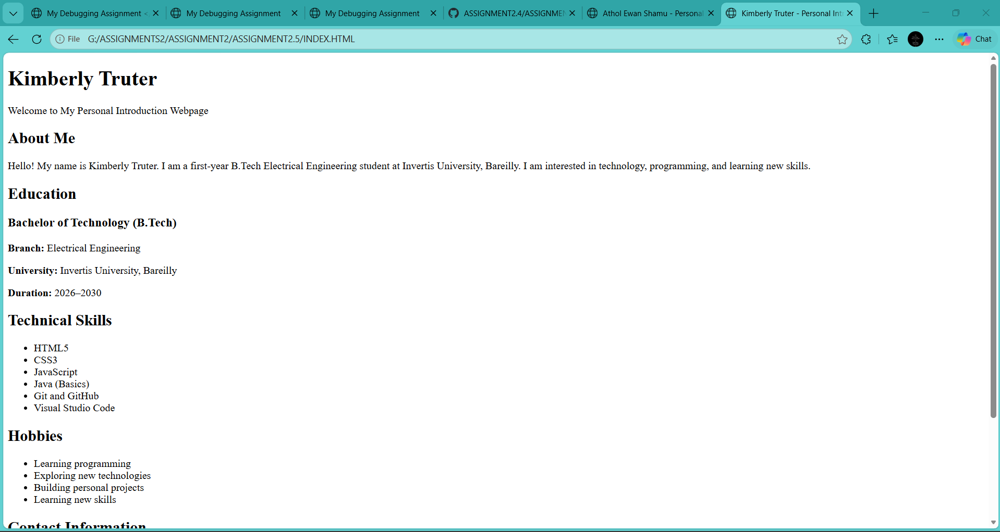

# Assignment 2.5 — HTML Foundations Mini-Project

**Name:** Athol Ewan Shamu\
**Course:** B.Tech Electrical Engineering\
**University:** Invertis University, Bareilly

## 1. Aim

To build a complete personal introduction webpage using basic HTML elements and semantic headings, covering personal information, education, technical skills, hobbies, and contact information.

## 2. Requirements

- A code editor such as Visual Studio Code.
- A web browser such as Google Chrome or Microsoft Edge.
- Git installed on the computer.
- A GitHub account.

## 3. Procedure

1. Open Visual Studio Code.
2. Create a project folder named `Assignment-2.5`.
3. Create a file named `index.html`.
4. Write the HTML code provided below.
5. Save the file and open it in a web browser.
6. Check that all sections and contact details are displayed correctly.
7. Initialize a Git repository, commit the code, and push it to GitHub.

## 4. HTML Elements Used

| HTML Element           | Purpose                          |
| ---------------------- | -------------------------------- |
| `<html>`               | Defines the HTML document        |
| `<head>`               | Contains page metadata           |
| `<title>`              | Sets the browser tab title       |
| `<body>`               | Contains visible webpage content |
| `<header>`             | Defines the introductory section |
| `<main>`               | Contains the main content        |
| `<section>`            | Groups related information       |
| `<h1>`, `<h2>`, `<h3>` | Define the heading hierarchy     |
| `
`                  | Creates paragraphs               |
| `<ul>` and `<li>`      | Display unordered lists          |
| `<a>`                  | Creates clickable links          |
| `<footer>`             | Defines the footer               |

## 5. Result

The personal introduction webpage was created successfully using HTML only. It includes About Me, Education, Technical Skills, Hobbies, and Contact Information sections, follows a proper HTML document structure, and is ready to be committed to a Git repository and submitted through GitHub.

## 5. OUTPUT OF PROJECT
